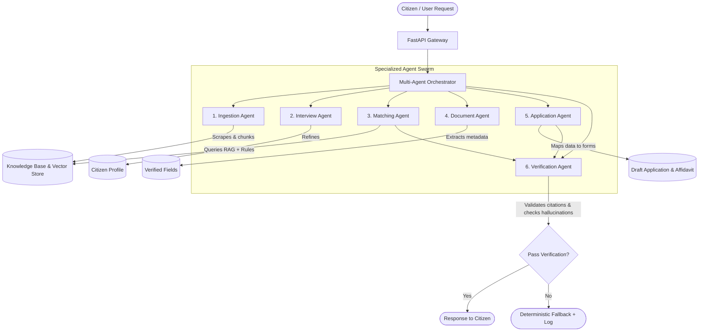
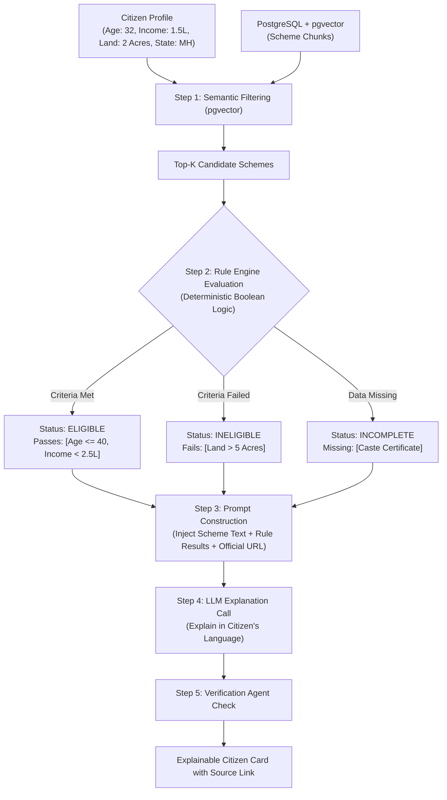
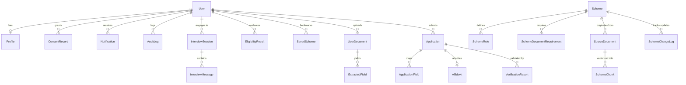
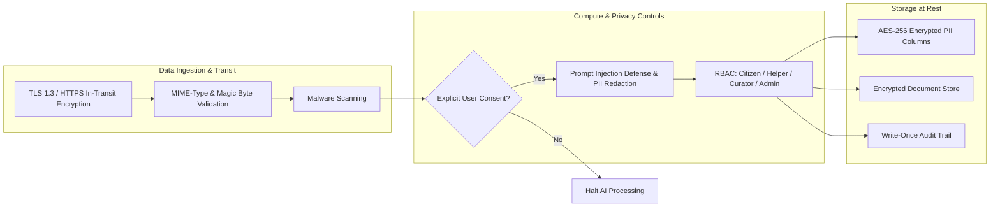
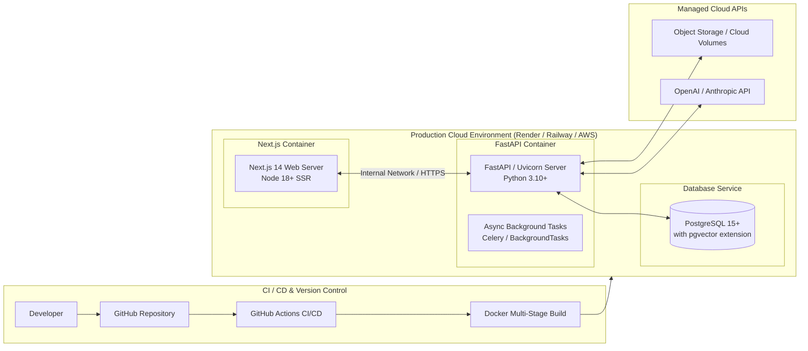

# Yojana Hunter — System Architecture Specification

> **An AI-Powered Platform for Government Scheme Discovery, Eligibility Matching, Document Verification, and Application Assistance**  
> **Core Architecture Formula:** `Agentic RAG + Eligibility Rule Engine + Document AI + Form Automation + Human-in-the-Loop`

---

## 1. Executive Summary & Architectural Goals

Yojana Hunter is engineered to overcome the two critical failure modes of existing government welfare portals and generic AI chatbots:
1. **Passive Catalog Portals:** Overwhelming citizens with bureaucratic jargon, vague eligibility rules, and unverified document requirements.
2. **Pure LLM Chatbots:** Hallucinating benefits, inventing non-existent rules, and lacking verifiable citations.

### Architectural Tenets
* **Deterministic Eligibility:** The Large Language Model (LLM) **never** determines eligibility alone. Eligibility is evaluated by a structured, deterministic **Rule Engine**, while the LLM handles natural language translation, conversational interviewing, and reasoning explanations.
* **Source of Truth Citations:** Every recommended scheme, rule match, and checklist item must trace back to official government gazettes, schemes, or ministry portals.
* **Human-in-the-Loop (HITL):** Autonomous form submissions are prohibited. The citizen (or assisted helper) reviews, verifies, and confirms all generated drafts and affidavits prior to submission.
* **Zero-Knowledge PII Protection:** Citizen personal data, Aadhaar details, and uploaded documents are encrypted at rest and in transit, governed by strict user consent flags.

---

## 2. Technology Stack

| Layer | Chosen Technology | Architecture Role & Justification |
| :--- | :--- | :--- |
| **Frontend Framework** | **Next.js 14+ (React, TypeScript)** | Modern App Router, Server-Side Rendering (SSR) for SEO and performance, responsive mobile-first UI, built-in internationalization (i18n) for regional Indian languages. |
| **Frontend Styling** | **Tailwind CSS + Lucide Icons** | Utility-first styling for fast, accessible, and clean design across mobile and desktop breakpoints. |
| **Backend Framework** | **Python 3.10+ with FastAPI** | High-performance asynchronous REST API, auto-generated OpenAPI/Swagger documentation, native Pydantic validation, and rich ecosystem for AI/ML pipelines. |
| **Primary Database** | **PostgreSQL 15+** | ACID-compliant relational storage for user profiles, scheme definitions, applications, audit logs, and JSONB support for dynamic rule specifications. |
| **Vector Store** | **pgvector (PostgreSQL Extension)** | Native vector embeddings stored directly inside PostgreSQL, eliminating sync issues between separate vector databases and relational data. |
| **ORM & Migrations** | **SQLAlchemy 2.0 (Async) + Alembic** | Robust object-relational mapping, connection pooling, and schema migration tracking. |
| **LLM & Agent Orchestration** | **OpenAI / Anthropic APIs + Custom Multi-Agent Orchestrator** | 6 specialized agents for Ingestion, Interview, Matching, Documents, Applications, and Verification. |
| **Embeddings Model** | **sentence-transformers (`all-MiniLM-L6-v2` / `bge-small-en-v1.5`)** | High-efficiency semantic embeddings for scheme chunks and citizen query similarity search. |
| **Document Processing & OCR** | **Tesseract OCR / Google Cloud Document AI, PyMuPDF, Pillow, pdf2image** | Multi-format document text and field extraction (Aadhaar, income certificates, caste certificates, land records). |
| **Form & PDF Generation** | **ReportLab / WeasyPrint** | Programmatic generation of standardized application drafts and self-declaration affidavit PDFs. |
| **Security & Authentication** | **JWT (python-jose), bcrypt (passlib), SlowAPI** | Secure bearer token auth, salted password hashing, rate limiting, and role-based access control (RBAC). |
| **Containerization & DevOps** | **Docker & Docker Compose** | Unified local development and production container packaging for backend, frontend, and PostgreSQL + pgvector. |

---

## 3. High-Level System Architecture

Yojana Hunter follows a strictly decoupled, layered architecture where API routes remain thin, delegating all domain logic to a Python service layer and multi-agent orchestrator:

```mermaid
graph TB
    subgraph CLIENT ["Client Layer (User Browser & Mobile Devices)"]
        UI["Next.js Responsive Web App (SSR / React)"]
        ChatUI["Conversational Interview UI"]
        DocUI["Document Upload & OCR Review"]
        LangUI["Multilingual Switcher (i18n)"]
    end

    subgraph API_GW ["Application Layer (FastAPI API Gateway)"]
        RouterAuth["/api/v1/auth"]
        RouterProfile["/api/v1/profile"]
        RouterInterview["/api/v1/interview"]
        RouterSchemes["/api/v1/schemes"]
        RouterEligibility["/api/v1/eligibility"]
        RouterDocs["/api/v1/documents"]
        RouterApps["/api/v1/applications"]
        RouterAdmin["/api/v1/admin"]
    end

    subgraph ORCHESTRATOR ["Multi-Agent Orchestration Layer"]
        AgentManager["Multi-Agent System Orchestrator"]
        IngestAg["1. Scheme Ingestion Agent"]
        IntervAg["2. Interview Agent"]
        MatchAg["3. Matching Agent"]
        DocAg["4. Document Agent"]
        AppAg["5. Application Agent"]
        VerifyAg["6. Verification Agent"]
    end

    subgraph CORE_SERVICES ["Service Layer (Business Logic & Intelligence)"]
        RuleEng["Deterministic Rule Engine"]
        RAGServ["RAG Retrieval Service"]
        OCRServ["OCR & Field Extractor"]
        FormFill["Form Autofill & Affidavit Builder"]
        AuditServ["Security & Consent Manager"]
    end

    subgraph DATA_STORAGE ["Data Layer (PostgreSQL + pgvector)"]
        RelTables[("PostgreSQL Relational Tables<br>(Users, Schemes, Apps, Audits)")]
        VecTables[("pgvector Embeddings<br>(scheme_chunks)")]
        FileStore[("Encrypted File Storage<br>(User Document Uploads)")]
    end

    subgraph EXTERNAL ["External Providers & Services"]
        LLM_API["LLM APIs (OpenAI / Anthropic)"]
        GovPortals["Official Government Websites & Gazettes"]
        DocAI["OCR Engine (Tesseract / Cloud Doc AI)"]
    end

    CLIENT <-->|HTTPS / REST / JSON| API_GW
    API_GW <--> ORCHESTRATOR
    ORCHESTRATOR <--> CORE_SERVICES
    CORE_SERVICES <--> DATA_STORAGE
    CORE_SERVICES <--> EXTERNAL
```



---

## 4. Multi-Agent System Architecture

Six specialized agents operate autonomously under the central orchestrator, sharing a single verified knowledge base:



### Detailed Agent Responsibilities:
1. **Scheme Ingestion Agent:** Monitors official government portal URLs and PDFs, parses text using `PyMuPDF`/`pdfplumber`, creates semantic chunks, generates vector embeddings, and registers structured JSON rules.
2. **Interview Agent:** Employs an empathetic, non-technical conversational style (in Hindi, Marathi, Tamil, English, etc.) to uncover implicit eligibility data (e.g., annual family income, land holding size in acres, occupation type, disability status).
3. **Matching Agent:** Executes a two-stage filter:
   * *Stage 1:* Semantic pre-filtering via `pgvector` cosine similarity.
   * *Stage 2:* Boolean rule validation via the Deterministic Rule Engine.
4. **Document Agent:** Inspects uploaded scans/images, conducts quality checks, runs OCR, matches extracted names/numbers with citizen profile inputs, and flags discrepancies.
5. **Application Agent:** Maps verified profile fields to target government form schemas and populates draft PDFs and self-declaration affidavits.
6. **Verification Agent:** Serves as the guardian against hallucination: validates every statement against retrieved chunk IDs, ensures citations are accurate, and verifies arithmetic logic.

---

## 5. RAG & Deterministic Rule Engine Integration

The core differentiator of Yojana Hunter is that **eligibility decisions are deterministic, not probabilistic**.



### Rule Engine Specification (JSONB Schema in PostgreSQL)
Rules are stored in `scheme_rules` as declarative conditions:
```json
{
  "operator": "AND",
  "conditions": [
    {"field": "age", "op": ">=", "value": 18},
    {"field": "age", "op": "<=", "value": 40},
    {"field": "annual_income", "op": "<=", "value": 250000},
    {"field": "state", "op": "in", "value": ["Maharashtra", "All India"]},
    {"field": "occupation", "op": "eq", "value": "Farmer"}
  ]
}
```

---

## 6. Database Schema & PostgreSQL Architecture

The relational database consists of **22 normalized entities** categorized into five functional domains.



### Table Domains Breakdown:
1. **Users & Trust Domain:**
   * `users`: Primary auth record (id, email/phone, password_hash, role).
   * `profiles`: Demographic data (age, gender, occupation, income, caste, state, district).
   * `consent_records`: Timestamped consent for AI processing and PII usage.
   * `notifications`: User alerts on status changes, document deadlines.
   * `audit_logs`: Immutable security log of sensitive operations.
2. **Schemes & Knowledge Domain:**
   * `schemes`: Primary scheme directory (title, ministry, category, benefits).
   * `scheme_rules`: Declarative JSONB eligibility rules for the rule engine.
   * `scheme_document_requirements`: Compulsory vs optional document definitions.
   * `source_documents`: Raw government PDFs, gazettes, official portal links.
   * `scheme_chunks`: Text chunks with `vector(384)` embeddings indexed with HNSW.
   * `scheme_change_logs`: Versioning and diff tracking when government policies update.
3. **Citizen Journey Domain:**
   * `interview_sessions`: Active conversational state.
   * `interview_messages`: Message history (role: user/assistant, language).
   * `eligibility_results`: Historical match calculations with criteria breakdown.
   * `saved_schemes`: User bookmarks and tracked opportunities.
4. **Documents & Applications Domain:**
   * `user_documents`: Uploaded document metadata, encrypted file paths.
   * `extracted_fields`: OCR extracted key-value pairs (Aadhaar, income number, dates).
   * `applications`: Application drafts per scheme.
   * `application_fields`: Field-level mapping values and user edits.
   * `affidavits`: Self-declaration draft PDFs generated for user confirmation.
5. **AI Insights Domain:**
   * `verification_reports`: Output of verification agent (confidence score, hallucination check).
   * `agent_runs`: Telemetry and timing for multi-agent execution steps.
   * `retrieval_logs`: RAG retrieval performance and query metrics.

---

## 7. Security, Privacy & PII Architecture



* **Zero Plaintext Storage:** Passwords hashed using `bcrypt` (work factor 12).
* **PII Column Encryption:** Sensitive identity fields (Aadhaar, PAN, Bank IFSC) are encrypted in PostgreSQL using AES-256.
* **Consent-Gated AI:** No LLM call is executed unless `consent_records` has an active grant flag from the user. Users can revoke consent or request data purge at any time.
* **Prompt Injection Defense:** Strict input sanitization prevents injected jailbreak instructions inside citizen chats or scanned document text.

---

## 8. Deployment & Infrastructure Architecture



---

## 9. Architectural Summary Matrix

| Metric | Architecture Target | Implementation Mechanism |
| :--- | :--- | :--- |
| **Search Response Time** | < 2.0 seconds | Indexed PostgreSQL columns + HNSW `pgvector` indexing |
| **AI Interview Response** | < 8.0 seconds | Streaming FastAPI responses + prompt optimization |
| **Eligibility Accuracy** | 100% deterministic | Deterministic Python Rule Engine on verified parameters |
| **Hallucination Rate** | 0% on scheme benefits | Verification Agent citation checking against source chunks |
| **Concurrent Users** | 100+ active users | Async FastAPI runtime + connection pooling via SQLAlchemy |
| **Data Protection** | Full DPDP / GDPR compliance | Explicit consent toggles + AES-256 encryption at rest |
