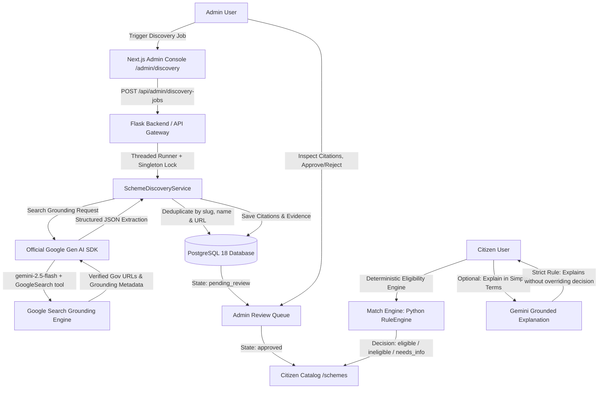

# Yojana Hunter — Gemini-Powered Government Scheme Discovery & Verification Guide

## 1. System Architecture & Data Flow



---

## 2. Environment Variables & Key Security

All Gemini and database secrets are stored strictly on the server in `backend/.env`. The client-side browser **never** receives or has access to `GEMINI_API_KEY`.

### `backend/.env` Configuration
```env
# Flask Application Environment
FLASK_ENV=development
SECRET_KEY=yojana-hunter-production-secret-key-change-in-prod-2026
JWT_SECRET=yojana-hunter-jwt-secure-token-secret-2026

# PostgreSQL 18 Connection String (psycopg dialect)
DATABASE_URL=postgresql+psycopg://postgres:<YOUR_POSTGRES_PASSWORD>@localhost:5432/yojana_hunter

# Google Gen AI (Gemini) Configuration
GEMINI_API_KEY=your_actual_gemini_api_key_here
GEMINI_MODEL=gemini-2.5-flash
GEMINI_MAX_RETRIES=3
GEMINI_TIMEOUT_SECONDS=45

# Grounded Discovery Service Limits
DISCOVERY_MAX_REQUESTS=8
DISCOVERY_MAX_SCHEMES_PER_QUERY=5
```

> **Security Rule:** Real API keys are never printed in logs, test output, or committed to Git. `GeminiService.sanitize_error_message()` actively redacts Google API key tokens matching `AIza...` and any key substrings.

---

## 3. Official Google Gen AI Python SDK Integration

Yojana Hunter uses the **official Google Gen AI SDK** (`google-genai` v2.30.1):

```python
from google import genai
from google.genai import types

client = genai.Client(api_key=gemini_api_key)

# Configured with live Google Search grounding
config = types.GenerateContentConfig(
    tools=[types.Tool(google_search=types.GoogleSearch())],
    temperature=0.1,
    max_output_tokens=3500
)

response = client.models.generate_content(
    model="gemini-2.5-flash",
    contents=discovery_prompt,
    config=config
)
```

### Grounding Metadata Extraction
For each discovered scheme, the service extracts official source citations from:
- `candidate.grounding_metadata.grounding_chunks` (contains `web.uri` and `web.title`)
- `candidate.grounding_metadata.web_search_queries`
- Persisted to PostgreSQL table `scheme_citations` linked to the discovered scheme.

---

## 4. PostgreSQL 18 Schema & Database Tables

The database schema supports complete audit trails, citation evidence, and review history:

| Table Name | Description | Key Columns |
|---|---|---|
| `schemes` | Core scheme repository | `id`, `slug`, `name`, `status`, `application_status`, `admin_review_status`, `official_url`, `application_url` |
| `scheme_citations` | Official web evidence & URLs | `id`, `scheme_id`, `source_title`, `source_url`, `excerpt`, `confidence_score` |
| `discovery_jobs` | Discovery runs & statistics | `id`, `job_id`, `status`, `scope_state`, `scope_category`, `discovered_count`, `created_count`, `duplicate_count` |
| `discovery_job_logs` | Real-time audit logs | `id`, `job_id`, `level`, `message`, `details`, `timestamp` |
| `scheme_review_histories` | Admin action audits | `id`, `scheme_id`, `admin_id`, `action`, `reason`, `previous_data`, `new_data` |
| `scheme_change_logs` | Detected scheme rule diffs | `id`, `scheme_id`, `change_type`, `summary`, `old_values`, `new_values` |

### Database Migration
To apply or verify database schema updates non-destructively:
```powershell
& ".\backend\venv\Scripts\python.exe" backend/migrate_gemini_discovery.py
```

---

## 5. Starting the Application (Windows PowerShell)

### Step 1: Start Backend (Flask)
```powershell
cd "c:\Users\SANKET MORE\Yojana_Hunter\backend"
& ".\venv\Scripts\python.exe" main.py
# Running on http://127.0.0.1:5000
```

### Step 2: Start Frontend (Next.js)
```powershell
cd "c:\Users\SANKET MORE\Yojana_Hunter\frontend"
npm run dev
# Running on http://localhost:3000
```

---

## 6. How Administrators Review & Approve Schemes

1. Navigate to `http://localhost:3000/admin/login` and log in with your administrative credentials.
2. Open **AI Scheme Discovery** from the admin sidebar (`/admin/discovery`).
3. Check **Gemini AI Service Configuration**:
   - If `GEMINI_API_KEY` is set, the status shows "Connected & Ready" with `gemini-2.5-flash`.
   - Click **Test Gemini API Connection** to verify live Search grounding.
4. Launch a Discovery Run:
   - Select State (e.g., Central, Maharashtra, Karnataka).
   - Select Category (e.g., Education & Scholarships, Agriculture & Farming).
   - Click **Execute Discovery Run**. A background worker with singleton lock executes safely without freezing web requests.
5. Review Newly Discovered Schemes:
   - Schemes appear in the **Discovered Schemes Verification Queue** with `pending_review` status.
   - Click **Inspect & Verify** to review direct benefits, criteria, official portal URLs, and supporting Google Search citations.
   - Click **Approve** to publish the scheme to the citizen portal.
   - Click **Reject** to dismiss the candidate scheme with a required audit reason.
   - Click **Request Re-verification** to flag ambiguous sources for administrator follow-up.

---

## 7. Deterministic Eligibility Matching vs. Safe Gemini Explanations

1. **Deterministic Rule Engine (`services/rule_engine.py`)**:
   - Compares citizen profile against verified criteria in Python.
   - Evaluates age, annual income, occupation, education, and state boundaries.
   - Strict logic: Unknown profile fields never default to false (`needs_info` instead of ineligible).
   - Returns structured results: `eligible`, `ineligible`, `needs_info`, or `applications_closed`.
2. **Safe Gemini Explanations (`services/gemini_service.py`)**:
   - On the scheme detail page (`/schemes/[schemeId]`), citizens can click **Explain in Simple Terms**.
   - Gemini translates the deterministic output into empathetic, plain-language text.
   - **Crucial Rule:** Gemini is strictly instructed never to override, alter, or fabricate eligibility decisions or deadlines.
   - If Gemini is offline or quota-limited, the system falls back to deterministic structured explanations instantly.

---

## 8. API Endpoint Reference

### Public Citizen Endpoints
- `GET /api/schemes` — Paginated scheme listing with keyword, state, and category filters.
- `GET /api/schemes/<scheme_id>` — Full scheme details, deadlines, and official portal links.
- `GET /api/schemes/categories` — Available scheme categories.
- `GET /api/schemes/states` — Available states and territories.
- `POST /api/schemes/match` — Deterministic profile matching against verified schemes.
- `POST /api/schemes/<scheme_id>/explain` — Grounded AI plain-language explanation.

### Administrative Endpoints (`Authorization: Bearer <admin_jwt>`)
- `GET /api/admin/gemini/status` — Gemini connection and model grounding diagnostics.
- `POST /api/admin/gemini/test` — Live bounded search grounding connection test.
- `POST /api/admin/discovery-jobs` — Trigger a new background discovery job.
- `GET /api/admin/discovery-jobs` — List past and active discovery jobs with summary counts.
- `GET /api/admin/discovery-jobs/<job_id>` — Detailed job audit logs and discovered schemes.
- `GET /api/admin/schemes/pending-review` — Discovered schemes review queue.
- `POST /api/admin/schemes/<scheme_id>/approve` — Approve scheme for publication.
- `POST /api/admin/schemes/<scheme_id>/reject` — Reject scheme with required audit reason.
- `POST /api/admin/schemes/<scheme_id>/reverify` — Flag scheme for re-verification.

---

## 9. Running Tests & Quality Verification

### Python Backend Tests
```powershell
& ".\backend\venv\Scripts\python.exe" -m pytest tests/test_gemini_service.py tests/test_discovery_service.py tests/test_admin_discovery_api.py tests/test_rule_engine.py -v
```

### Next.js TypeScript Type Check
```powershell
cd frontend
npx tsc --noEmit
```
Both test suites exit with **code 0 (100% pass, 0 compile errors)**.
