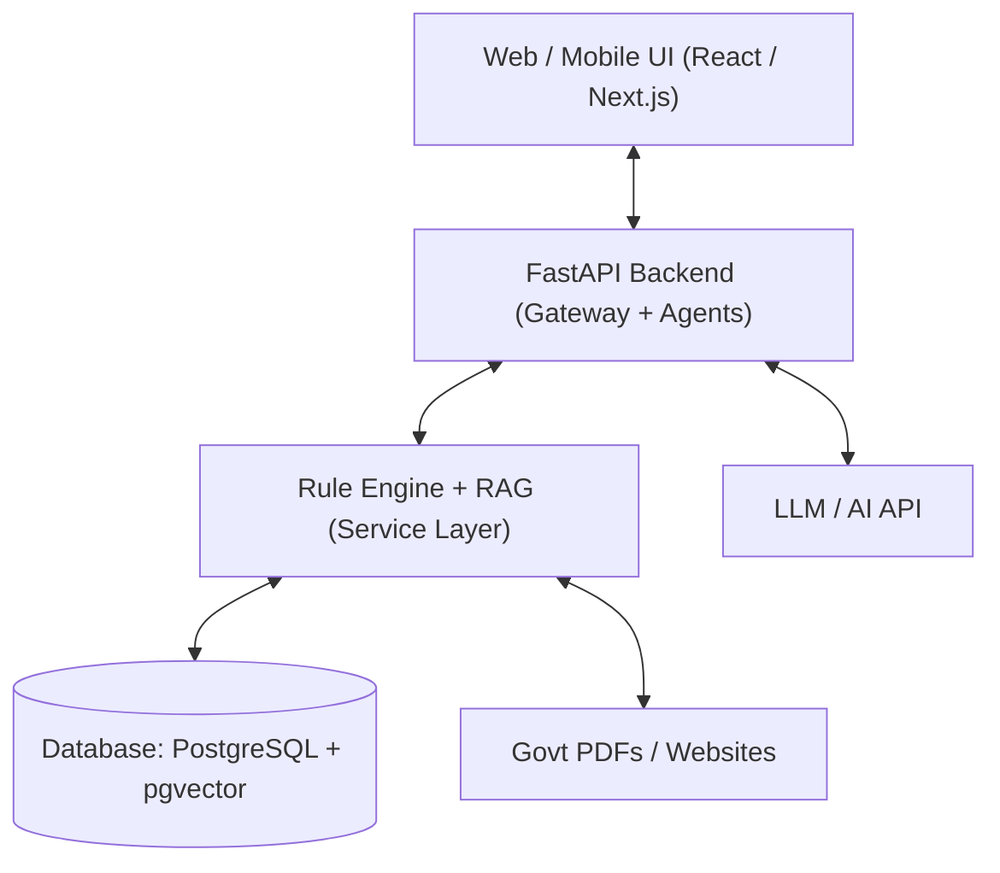
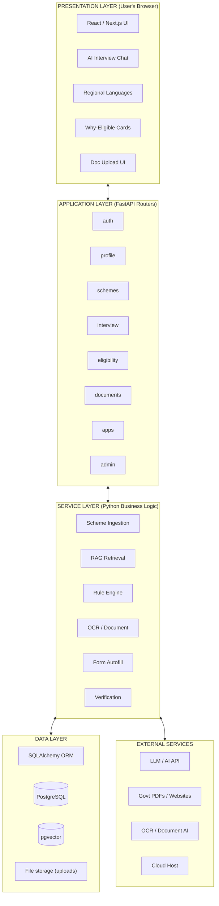
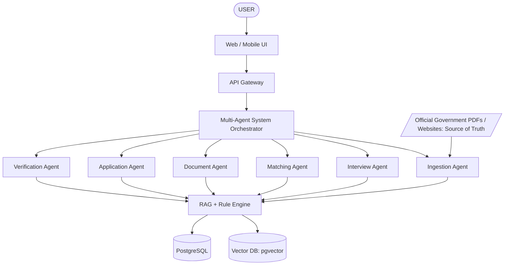
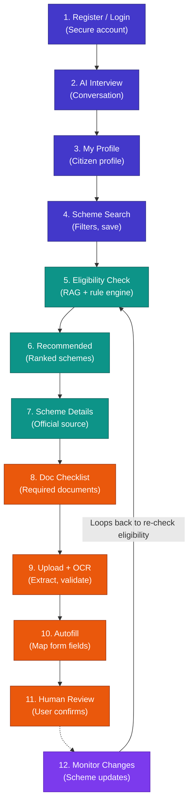
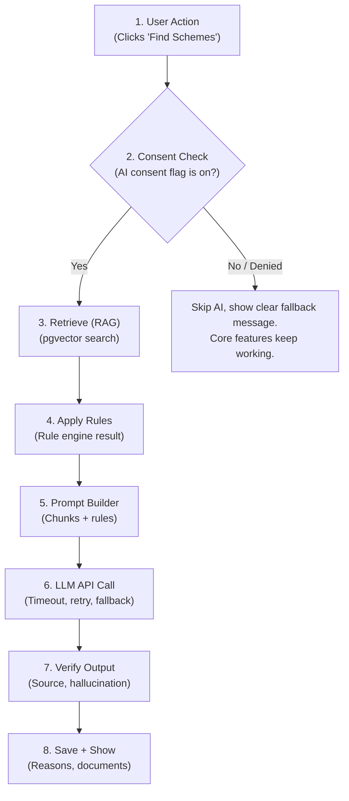
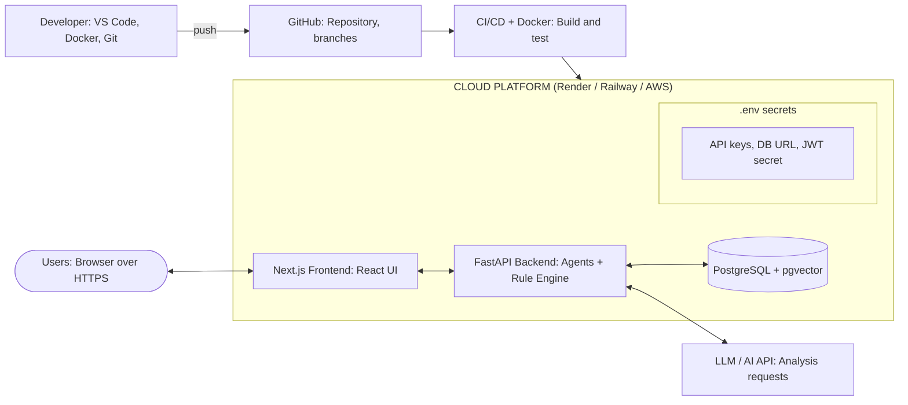

# Yojana Hunter
> **Beyond Searching Schemes, Getting Citizens the Benefits They Deserve**

---

## Document Metadata
* **Document Type:** Project Requirements Document (PRD)
* **Project Name:** Yojana Hunter
* **Repository:** [Aditimore05/Yojana_Hunter](https://github.com/Aditimore05/Yojana_Hunter.git)
* **Tagline:** An AI-powered platform for government scheme discovery, eligibility matching, document verification and application assistance
* **Technology Stack:** React / Next.js | FastAPI | PostgreSQL + pgvector | LLM + RAG | OCR | Docker
* **Core Formula:** `Yojana Hunter = Agentic RAG + Eligibility Rule Engine + Document AI + Form Automation + Human-in-the-Loop`

---

## Table of Contents
1. [Project Overview](#project-overview)
2. [1. Problem Statement](#1-problem-statement)
3. [2. Project Objectives](#2-project-objectives)
4. [3. Project Scope](#3-project-scope)
5. [4. Stakeholders / Users](#4-stakeholders--users)
6. [5. User Roles and Responsibilities](#5-user-roles-and-responsibilities)
7. [6. Functional Requirements](#6-functional-requirements)
8. [Core AI Features](#core-ai-features)
9. [7. Non-Functional Requirements](#7-non-functional-requirements)
10. [8. User Requirements](#8-user-requirements)
11. [9. Input Requirements](#9-input-requirements)
12. [10. Output Requirements](#10-output-requirements)
13. [11. Technology Requirements](#11-technology-requirements)
14. [12. Programming Language](#12-programming-language)
15. [13. Frontend Technology (React / Next.js)](#13-frontend-technology-react--nextjs)
16. [14. Backend Technology](#14-backend-technology)
17. [15. Database Technology](#15-database-technology)
18. [16. Python Packages / Libraries](#16-python-packages--libraries)
19. [17. Development Tools](#17-development-tools)
20. [18. Database Tools](#18-database-tools)
21. [19. Version Control](#19-version-control)
22. [20. GitHub Repository](#20-github-repository)
23. [21. Skills Required](#21-skills-required)
24. [22. System Architecture Requirements](#22-system-architecture-requirements)
25. [23. Database Requirements](#23-database-requirements)
26. [24. Hardware Requirements](#24-hardware-requirements)
27. [25. Software Requirements](#25-software-requirements)
28. [26. Security Requirements](#26-security-requirements)
29. [27. Performance Requirements](#27-performance-requirements)
30. [28. Project Methodology](#28-project-methodology)
31. [29. Constraints and Assumptions](#29-constraints-and-assumptions)
32. [30. In-Scope Features](#30-in-scope-features)
33. [31. Out-of-Scope Features](#31-out-of-scope-features)
34. [32. Future Enhancements](#32-future-enhancements)
35. [33. Requirement Summary](#33-requirement-summary)
36. [Appendix: Project Workflow and Architecture](#appendix-project-workflow-and-architecture)
    * [A. Layered System Architecture](#a-layered-system-architecture)
    * [B. Multi-Agent Architecture & Request Lifecycle](#b-multi-agent-architecture--request-lifecycle)
    * [C. End-to-End User Workflow](#c-end-to-end-user-workflow)
    * [D. AI Request Workflow](#d-ai-request-workflow)
    * [E. AI Feature Data Flow](#e-ai-feature-data-flow)
    * [F. Database Relationships (Key Links)](#f-database-relationships-key-links)
    * [G. Development Workflow & Sprints](#g-development-workflow--sprints)
    * [H. Deployment Architecture](#h-deployment-architecture)
    * [I. Project Folder Structure](#i-project-folder-structure)

---

## Project Overview

Yojana Hunter is an integrated, intelligent platform that helps citizens discover the government schemes they are genuinely eligible for, explains why they qualify, checks their documents and then helps them prepare the application, all with a human confirming every step. 

Unlike scheme portals that only list hundreds of schemes and leave citizens to decode the rules, Yojana Hunter interviews the citizen, builds a profile, matches it against verified scheme rules and treats the application as a guided journey with official sources shown at every step.

| Item | Detail |
| :--- | :--- |
| **Project type** | Full-stack web application with agentic AI features |
| **Core idea** | Discover + Match + Verify + Apply + AI scheme intelligence |
| **Key differentiator** | Agentic RAG + Eligibility Rule Engine + Document AI + Form Automation + Human-in-the-Loop; six specialised AI agents; **the LLM never decides eligibility alone** |
| **Target users** | Citizens, farmers, students, MSMEs, women and other beneficiary groups |

---

## 1. Problem Statement

Citizens, especially farmers, students, women and small business owners, struggle to find the government schemes meant for them. Scheme information is scattered across many websites and PDFs, eligibility rules are written in complex language, rules change without notice, and the required documents are rarely listed clearly. 

Many citizens miss benefits they qualify for, apply to schemes they are not eligible for, or have applications rejected because of missing or wrong documents and form errors.

Pure LLM chatbots make this worse because they can hallucinate eligibility or benefit amounts. Yojana Hunter addresses these gaps with an integrated platform that interviews the citizen, matches them against verified scheme rules, checks documents, drafts applications and explains every result in simple language with an official source.

---

## 2. Project Objectives

* **Match citizens to relevant schemes** using their profile: age, income, occupation, location, category and needs.
* **Improve trust** by showing the official source for every scheme and every eligibility decision.
* **Simplify the application journey:** eligibility, document checklist, form autofill and affidavit generation.
* **Detect missing information and missing documents early**, before the citizen applies.
* **Keep scheme data fresh** by detecting changes in official PDFs and websites automatically.
* **Never let the LLM decide eligibility alone:** use RAG plus a structured rule engine, and let the LLM only explain.
* **Provide explainable AI results** in simple and regional languages, with user consent and strong privacy protection.

---

## 3. Project Scope

The platform covers the complete scheme-benefit journey in three stages plus an AI layer:

| Stage | Scope |
| :--- | :--- |
| **1. Discover** | Registration/login, citizen profile, AI interview, scheme search and filters, saved schemes |
| **2. Match** | Eligibility matching, ranking, why-you-qualify explanation, official source display, missing-information prompts |
| **3. Apply** | Document checklist, upload and OCR verification, form autofill, affidavit generation, application draft, user confirmation |
| **4. AI layer** | Scheme Ingestion Agent, Interview Agent, Matching Agent, Document Agent, Application Agent, Verification Agent, RAG + Rule Engine |

> **Hackathon MVP scope:** 20–50 verified schemes (not 1000+) flowing through Citizen Interview, Eligibility Matching, Top Schemes, Document Checklist and Application Draft.

---

## 4. Stakeholders / Users

| Stakeholder | Interest |
| :--- | :--- |
| **Citizens** | Find schemes they qualify for, understand why, and know exactly which documents to bring |
| **Farmers** | Agriculture, subsidy, insurance and income-support schemes in simple regional language |
| **Students** | Scholarships, fee support and skill schemes with clear eligibility and deadlines |
| **MSMEs and entrepreneurs** | Loan, subsidy and registration schemes matched to business profile |
| **Women and other groups** | Targeted welfare, self-help and safety-net schemes |
| **Administrators** | Scheme data quality, user and document management, audit and monitoring |
| **Development team / evaluators** | Deliver and assess a working, well-documented system |

---

## 5. User Roles and Responsibilities

| Role | Responsibilities / Permissions |
| :--- | :--- |
| **Citizen (Guest to User)** | Register, complete AI interview, maintain profile, search schemes, save schemes, upload documents, review and confirm application drafts |
| **Assisted User (helper)** | Acts on behalf of a family member or beneficiary with their consent: runs interview, uploads documents, prepares drafts |
| **Scheme Data Curator** | Reviews ingested scheme data, approves structured eligibility rules, maintains official source links |
| **Reviewer / Verifier** | Reviews flagged verification reports, document mismatches and low-confidence AI outputs |
| **System Administrator** | Manage users, schemes and rules, monitor ingestion jobs, audit logs, security and system health |

---

## 6. Functional Requirements

| Module | Key requirements |
| :--- | :--- |
| **User and Auth** | Create account; secure login/logout; create and edit citizen profile; manage consent |
| **AI Interview** | Conversational interview in simple and regional language; identify missing information; build citizen profile |
| **Scheme Search** | Search and filter schemes by category, state, beneficiary group, benefit type; view details with official source; save schemes |
| **Eligibility Checking** | Match profile to structured rules; rank schemes; explain why the user qualifies or does not |
| **Document Verification** | Upload documents; OCR and field extraction; validate against requirements; list missing documents |
| **Form Autofill** | Map profile and document data to scheme form fields; generate application draft for review |
| **Affidavit Generation** | Generate self-declaration and affidavit drafts from profile data for user confirmation |
| **Scheme Ingestion** | Scrape official PDFs and websites; extract text; detect changes; update knowledge base and rules |
| **Administration** | Manage users, schemes, rules, ingestion jobs and audit logs |

---

## Core AI Features

| AI feature | Real-life problem | What it does |
| :--- | :--- | :--- |
| **1. Scheme Ingestion Agent** | Scheme rules are scattered across PDFs and sites and change often | Scrapes official sources, extracts text, detects changes and updates the knowledge base |
| **2. Interview Agent** | Citizens do not know which details decide eligibility | Converses in simple language, finds missing information, asks questions and builds the citizen profile |
| **3. Matching Agent** | Hundreds of schemes make it hard to know which apply | Retrieves relevant schemes with RAG, applies eligibility rules and ranks the results |
| **4. Document Agent** | Missing or wrong documents cause rejections | Runs OCR on uploads, extracts fields, validates documents and flags what is missing |
| **5. Application Agent** | Long forms and repeated data entry | Maps scheme form fields to the citizen profile, autofills and generates the application draft |
| **6. Verification Agent** | AI answers can hallucinate scheme facts | Checks official source, eligibility reasoning, missing information and hallucinations |
| **Eligibility Rule Engine** | An LLM alone cannot be trusted to decide eligibility | Applies structured rules extracted from government documents for a deterministic, explainable result |
| **Affidavit Generator** | Self-declarations and affidavits are drafted by hand | Creates an affidavit draft from the verified profile for the citizen to review and confirm |

---

## 7. Non-Functional Requirements

* **Usability:** Simple language, regional languages, clean responsive interface on desktop and mobile.
* **Security and privacy:** Hashed passwords, protected sessions, encrypted PII and documents, consent-based AI processing.
* **Performance:** Fast page loads and search; AI responses within an acceptable time.
* **Reliability and availability:** Graceful error handling; AI failures must not break core features.
* **Accuracy:** High retrieval and eligibility accuracy, with citations to official sources.
* **Explainability:** Every AI result shows its reasoning and official source in plain language.
* **Maintainability and scalability:** Modular code, clear structure, containerised deployment, horizontally scalable services.
* **Compatibility:** Works on current versions of Chrome, Edge, Firefox and Safari.

---

## 8. User Requirements

* Create an account and log in safely with minimal effort.
* Answer a simple conversational interview instead of filling long forms.
* Find schemes that fit my age, income, occupation, location and category.
* See why I qualify for a scheme, and see the official source for it.
* Know exactly which documents I need and which ones I am still missing.
* Get an autofilled application draft and confirm it before anything is submitted.
* Use the platform in my own language, in simple words.
* Control my personal data and choose whether AI may process it.

---

## 9. Input Requirements

| Area | Inputs |
| :--- | :--- |
| **Account/Profile** | Name, mobile/email, password, age, gender, occupation, state/district, category, family details, preferred language |
| **Interview** | Natural-language answers (text or voice later), income, land holding, education, business details, disability status |
| **Scheme data** | Official PDFs and website pages, scheme name, ministry, benefits, eligibility criteria, deadlines, form templates |
| **Documents** | Aadhaar-type ID, income certificate, caste certificate, bank details, land records, marksheets (images or PDFs) |
| **Application** | Selected scheme, confirmed profile data, form field mappings, user corrections |
| **AI inputs** | Interview messages, retrieved scheme chunks, structured rules, consent flags, OCR output |

---

## 10. Output Requirements

* Recommended schemes list with ranking, filters and sorting; scheme detail pages with official source.
* Eligibility result with why-you-qualify reasons, unmet criteria and missing information.
* Document checklist showing available, missing and invalid documents.
* Autofilled application draft and affidavit draft for review and confirmation.
* Verification report: source check, eligibility reasoning, hallucination check.
* Notifications for scheme changes, deadlines and missing documents; admin and audit reports; downloadable summaries.

---

## 11. Technology Requirements

| Layer | Choice |
| :--- | :--- |
| **Frontend** | React / Next.js with regional-language support |
| **Backend** | Python FastAPI (all application and agent logic in Python) |
| **Database** | PostgreSQL with pgvector as the vector store |
| **AI** | Suitable LLM API with RAG for retrieval, explanation and natural-language interview |
| **OCR** | Tesseract or a cloud Document AI service |
| **Authentication** | Session-based or JWT authentication with OTP option |
| **Version control** | Git + GitHub |
| **Deployment** | Docker + a suitable cloud platform (e.g., Render, Railway, AWS) |

---

## 12. Programming Language

* **Python 3.10+** is the primary language: backend logic, agents, RAG pipeline, rule engine, OCR integration and data handling.
* **TypeScript / JavaScript** is used only for the React / Next.js user interface.
* **SQL** is used through the Python ORM and for pgvector similarity queries.

---

## 13. Frontend Technology (React / Next.js)

* React / Next.js user interface, responsive and mobile-first, served over HTTPS.
* Conversational interview screen with simple language and regional language options.
* **Pages:**
  1. Home
  2. AI Interview
  3. My Profile
  4. Recommended Schemes
  5. Scheme Details
  6. Required Documents
  7. Application Assistant
* **UX rules:** Explain why the user qualifies, show the official source, show missing documents, and require user confirmation before submission.

---

## 14. Backend Technology

* FastAPI with modular routers (`auth`, `profile`, `schemes`, `interview`, `eligibility`, `documents`, `applications`, `admin`).
* Multi-agent orchestration behind an API gateway; service layer for RAG, rule engine, OCR and autofill.
* Secure session or JWT handling; Pydantic input validation and structured error handling.

---

## 15. Database Technology

* PostgreSQL as the primary relational store; `pgvector` for scheme-chunk embeddings and semantic search.
* SQLAlchemy ORM with Alembic migrations.
* Relational design with foreign keys, indexes on search fields and JSONB columns for structured eligibility rules.

---

## 16. Python Packages / Libraries

| Purpose | Packages |
| :--- | :--- |
| **Web framework** | `FastAPI`, `Uvicorn`, `Pydantic`, `python-multipart` |
| **Database** | `SQLAlchemy`, `Alembic`, `psycopg`, `pgvector` |
| **Security** | `passlib/bcrypt`, `python-jose` (JWT), `slowapi`, `python-dotenv`, `cryptography` |
| **AI / data** | `OpenAI` or `Anthropic` SDK, `sentence-transformers` or API embeddings, `LangChain` or `LlamaIndex` (optional), `pandas`, `numpy` |
| **Ingestion** | `requests`, `BeautifulSoup`, `Playwright` (dynamic pages), `PyMuPDF`, `pdfplumber` |
| **OCR / documents** | `pytesseract`, `Tesseract`, `Pillow`, `pdf2image` (or cloud Document AI SDK) |
| **Forms / PDF output** | `reportlab` or `WeasyPrint` for application drafts and affidavits |
| **Frontend** | `Next.js`, `React`, `Tailwind CSS`, `i18n` library for regional languages |
| **Testing / deploy** | `pytest`, `Jest`, `Docker`, `GitHub Actions` |

---

## 17. Development Tools

* VS Code (or PyCharm), Python virtual environment (`venv`), `pip`, `Node.js` and `npm`.
* Docker and Docker Compose for local services; Postman for API testing; browser DevTools for debugging.
* Figma or a wireframing tool for UI design; draw.io for architecture and ER diagrams.

---

## 18. Database Tools

* pgAdmin or DBeaver for PostgreSQL design, inspection and querying.
* dbdiagram.io / draw.io for ER diagrams; Alembic for schema versioning.

---

## 19. Version Control

Git is used for tracking changes with small, meaningful commits and feature branches (`main`, `develop`, `feature/*`). Pull requests and code review are used before merging.

---

## 20. GitHub Repository

* **Repository:** `yojana-hunter` with README (setup, features, screenshots), `.gitignore` and `requirements.txt`.
* **Suggested structure:** `backend/` (`api`, `models`, `agents`, `services`), `frontend/`, `tests/`, `docs/`, `docker-compose.yml`.
* Secrets kept out of Git via `.env`; Issues and Projects board used for task tracking.

---

## 21. Skills Required

| Area | Skills |
| :--- | :--- |
| **Development** | Python, FastAPI, React / Next.js, SQLAlchemy, REST APIs, Docker |
| **AI** | Prompt engineering, LLM API integration, RAG, embeddings, agent orchestration, rule engines, OCR |
| **Design** | UI/UX basics, multilingual and accessible design, database modeling |
| **Quality and security** | Testing, debugging, authentication, PII protection, prompt-injection defence |
| **Tools and delivery** | Git/GitHub, CI/CD, deployment, documentation, government-scheme research |

---

## 22. System Architecture Requirements

A layered architecture separates presentation, business logic, data and AI services:



* Modular FastAPI routers; business logic separated from routes.
* AI calls only through a service layer, with caching, timeouts and fallbacks.
* Eligibility decided by the rule engine, never by the LLM alone; the LLM only explains the result.
* Stateless API design so the app can scale and move to the cloud easily.

---

## 23. Database Requirements

Main entities, grouped by purpose (about 22 tables):

| Group | Entities |
| :--- | :--- |
| **Users and trust** | `User`, `Profile`, `ConsentRecord`, `Notification`, `AuditLog` |
| **Schemes and knowledge** | `Scheme`, `SchemeRule`, `SchemeDocumentRequirement`, `SourceDocument`, `SchemeChunk` (embedding), `SchemeChangeLog` |
| **Citizen journey** | `InterviewSession`, `InterviewMessage`, `EligibilityResult`, `SavedScheme` |
| **Documents and application** | `UserDocument`, `ExtractedField`, `Application`, `ApplicationField`, `Affidavit` |
| **AI insights** | `VerificationReport`, `AgentRun`, `RetrievalLog` |

* Referential integrity, indexed search columns, soft deletes, timestamps for scheme-change tracking, encrypted PII columns and regular backups.

---

## 24. Hardware Requirements

| Item | Development | Deployment |
| :--- | :--- | :--- |
| **Processor** | Dual-core or better | 2 vCPU cloud instance |
| **RAM** | 8 GB recommended (4 GB minimum) | 4 GB (more if OCR runs locally) |
| **Storage** | 10 GB free | 10–20 GB (documents, embeddings, database) |
| **Network** | Stable internet for AI API | Reliable, HTTPS enabled |

---

## 25. Software Requirements

| Item | Requirement |
| :--- | :--- |
| **Operating system** | Windows 10/11, macOS or Linux |
| **Runtime** | Python 3.10+, pip, virtual environment, Node.js 18+ |
| **Database** | PostgreSQL 15+ with pgvector extension |
| **Browser** | Latest Chrome, Edge, Firefox or Safari |
| **Other** | Git, Docker, Tesseract OCR, VS Code, Postman, AI API key |

---

## 26. Security Requirements

* **Password hashing** (e.g., bcrypt); never store plain-text passwords; optional OTP login.
* **Secure authentication and role-based authorization** (citizen, helper, curator, reviewer, admin).
* **PII protection:** Encryption at rest and in transit; data visible only to the owning citizen and authorised roles.
* **Secure document uploads:** Type/size validation, safe file names, encrypted storage, malware scanning where possible.
* **API keys** stored in environment variables, never in code or GitHub.
* **Explicit user consent** before AI processing; option to withdraw consent and delete data.
* **Prompt-injection defence** for ingested documents and user messages; CSRF, XSS and SQL-injection protection; HTTPS; rate limiting.
* **Audit logs** for sensitive actions, and user confirmation before any submission.

---

## 27. Performance Requirements

* Standard pages load in under 3 seconds; scheme search and filter results within 2 seconds.
* AI interview replies and scheme recommendations within about 10 seconds, with a loading indicator and fallback message.
* Document OCR and extraction completed within an acceptable time per document, processed asynchronously.
* Supports at least 100 concurrent users in the prototype; paginated lists and indexed queries.
* Failed AI calls are retried or cached.

---

## 28. Project Methodology

An iterative, Agile-style approach is followed:

| Phase | Activities |
| :--- | :--- |
| **Requirement gathering** | Identify users and government data sources; define functional and non-functional requirements; produce BRD, SRS and use cases |
| **Planning and scope** | Limit the MVP to 20–50 verified schemes; select the tech stack |
| **UI/UX design** | Wireframes, user flows, simple and regional-language content, explainability patterns |
| **Development** | Build in order: Database + APIs, Scheme ingestion, RAG search, Eligibility engine, AI interview, Document/OCR, Form autofill, Frontend integration |
| **Testing** | Functional, AI (RAG accuracy, eligibility accuracy, hallucination rate, citation accuracy), Security (PII, auth, document security, prompt injection) and Performance testing |
| **Deployment** | GitHub, CI/CD, Docker, cloud deployment with logging, monitoring, error tracking and audit logs |

---

## 29. Constraints and Assumptions

### Constraints
* Limited hackathon time and team size; dependence on a third-party AI API (cost, rate limits, availability).
* Only 20–50 verified schemes in the MVP; scheme data quality depends on official sources.
* No direct government API integration or authorised online submission in the first release.

### Assumptions
* Users have internet access and a modern browser.
* Users provide honest data and consent to AI processing.
* AI output is advisory support, and the citizen confirms every application before submission.

---

## 30. In-Scope Features

* Registration/login, citizen profile, AI interview, scheme search and filters, saved schemes.
* Eligibility matching with rule engine, ranking and explanations with official sources.
* Document checklist, upload, OCR verification, form autofill, affidavit and application draft generation.
* All six AI agents with RAG and rule engine, verification checks and human-in-the-loop confirmation.
* Admin panel, basic testing and cloud deployment.

---

## 31. Out-of-Scope Features

* Native mobile apps (iOS/Android) and autonomous online submission to government portals.
* Direct government API integration and legal representation or legal advice.
* Payment processing, e-KYC and biometric identity checks.
* Coverage of 1000+ schemes, voice assistant and WhatsApp integration in the first release.

---

## 32. Future Enhancements

* More government schemes; regional language expansion.
* Voice assistant and WhatsApp integration.
* Government API integration; authorised online submission.
* Trained ML models on real usage data; smarter change detection and fraud checks.
* Mobile apps and push notifications; analytics dashboard.

---

## 33. Requirement Summary

| Category | Summary |
| :--- | :--- |
| **Purpose** | AI-powered scheme discovery, eligibility matching, document verification and application assistance |
| **Users** | Citizens, farmers, students, MSMEs, women, helpers, curators, admins |
| **Tech stack** | React / Next.js + FastAPI + PostgreSQL + pgvector + LLM + RAG + OCR + Docker + cloud |
| **Main modules** | Auth, AI Interview, Scheme Search, Eligibility, Documents, Form Autofill, Ingestion, Admin |
| **AI differentiators** | Scheme Ingestion, Interview, Matching, Document, Application and Verification Agents with a rule engine |
| **Quality goals** | Secure, private, explainable, accurate and easy to use |
| **Testing** | Functional, AI, Security and Performance testing |

---

## Appendix: Project Workflow and Architecture

This appendix details how Yojana Hunter is structured and how work and data flow through it. The backend and agents are built in Python (FastAPI); the interface is built with React / Next.js.

### A. Layered System Architecture



> **Architectural Principle:** Requests move down the layers and responses come back up. Routes stay thin; all matching, eligibility and AI logic lives in the Python service layer so it can be tested and reused.

---

### B. Multi-Agent Architecture & Request Lifecycle



* Six specialised agents share one knowledge base.
* The **Verification Agent** checks sources, reasoning, missing information and hallucinations before results reach the citizen.

#### Typical Request Lifecycle

| Step | What happens |
| :---: | :--- |
| **1. Request** | Citizen sends a message or action from the React / Next.js UI; the browser sends an HTTPS request to the API. |
| **2. Route + security** | FastAPI router runs; token/session is checked, role is authorized, input is validated and rate-limited. |
| **3. Service logic** | Route calls a service or agent (e.g., interview, matching, document, application). |
| **4. Data access** | Service reads/writes PostgreSQL through SQLAlchemy and queries pgvector for relevant scheme chunks. |
| **5. AI call (if needed)** | AI service checks consent, builds the prompt from retrieved chunks and rule results, calls the LLM API and validates the reply. |
| **6. Render** | Frontend fills the page with schemes, reasons, official sources and missing documents. |
| **7. Response** | Server returns JSON to the UI, which renders the result or shows a clear fallback message. |

---

### C. End-to-End User Workflow



* **Colors / Stages:** Indigo = Discover, Teal = Match, Orange = Apply, Purple = AI layer.
* **Step 12 (Change Monitoring):** Loops back to Step 5 to re-check eligibility when an official scheme changes.

---

### D. AI Request Workflow



> **Fail-Safe Principle:** If the consent check fails or the API errors out, the app skips AI and shows a clear message; core features keep working. **Eligibility always comes from the rule engine, never from the LLM alone.**

---

### E. AI Feature Data Flow

| AI feature | Input data | Processing | Output |
| :--- | :--- | :--- | :--- |
| **Scheme Ingestion Agent** | Official govt PDFs and websites | Scrape, extract text, detect changes, chunk and embed | Updated knowledge base and rules |
| **Interview Agent** | Citizen conversation, current profile | Identify missing information, ask follow-up questions | Complete citizen profile |
| **Matching Agent** | Citizen profile, scheme chunks, rules | Retrieve schemes via RAG, apply eligibility rules, rank | Ranked schemes with reasons |
| **Document Agent** | Uploaded documents (images/PDFs) | OCR, extract fields, validate against requirements | Verified data, missing-document list |
| **Application Agent** | Scheme form, profile, extracted fields | Map fields, auto-fill, generate affidavit | Application and affidavit drafts |
| **Verification Agent** | AI output, retrieved sources | Check official source, reasoning, gaps, hallucinations | Verification report, confidence flags |
| **Rule Engine** | Structured eligibility rules, profile | Deterministic rule evaluation | Eligible / not eligible with criteria met |

---

### F. Database Relationships (Key Links)

| Relationship | Meaning |
| :--- | :--- |
| `User 1-1 Profile, ConsentRecord` | Each user has one citizen profile and consent settings |
| `User 1-N InterviewSession; Session 1-N InterviewMessage` | Conversations that build the profile |
| `Scheme 1-N SchemeRule, SchemeDocumentRequirement` | Structured eligibility rules and required documents per scheme |
| `SourceDocument 1-N SchemeChunk` | Official PDFs and pages split into embedded chunks for RAG |
| `Scheme 1-N SchemeChangeLog` | Detected changes that trigger re-checks |
| `User N-N Scheme via EligibilityResult, SavedScheme` | Match results and saved schemes per citizen |
| `User 1-N UserDocument; Document 1-N ExtractedField` | Uploaded documents and OCR fields |
| `User 1-N Application; Application 1-N ApplicationField` | Drafts mapped field by field; Application 1-1 Affidavit |
| `Application 1-N VerificationReport` | Verification results for each draft |
| `User 1-N Notification, AuditLog` | Alerts and an audit trail of sensitive actions |

---

### G. Development Workflow & Sprints

#### Project Phases
| Phase | Key activities | Deliverable |
| :---: | :--- | :--- |
| **1. Requirements** | Identify users, government data sources, functional and non-functional requirements | BRD, SRS, use cases |
| **2. Planning and design** | Scope MVP to 20–50 schemes, wireframes, ER diagram, architecture, user flows | UI mockups, DB schema |
| **3. Environment setup** | Python, venv, FastAPI structure, PostgreSQL + pgvector, Docker, Git/GitHub, `.env`, AI API key | Running starter app on GitHub |
| **4. Development** | Build in sprints (below) | Working modules |
| **5. Testing** | Functional, AI, security and performance tests | Test log, bug fixes |
| **6. Deployment** | CI/CD, Docker, cloud setup, environment secrets, HTTPS | Live URL |
| **7. Review** | Feedback, documentation, final report and demo | Final submission |

#### Sprints Plan
| Sprint | Module | Main tasks |
| :---: | :--- | :--- |
| **1** | Database + APIs | Schema, auth, profile APIs, password hashing, sessions |
| **2** | Scheme Ingestion | Scrape PDFs/sites, extract text, change detection, knowledge base update |
| **3** | RAG Search | Chunking, embeddings, pgvector search, citations |
| **4** | Eligibility Engine | Structured rules, rule engine, ranking, explanations |
| **5** | AI Interview | Interview agent, missing-information detection, profile building |
| **6** | Document / OCR | Upload, OCR, field extraction, validation, missing-document list |
| **7** | Form Autofill | Field mapping, autofill, application and affidavit drafts, verification agent |
| **8** | Frontend, Admin, Testing | UI integration, admin panel, bug fixes, UAT, deployment |

---

### H. Deployment Architecture



* Code is pushed to GitHub, built and tested by CI/CD, and deployed with Docker to a cloud platform.
* Secrets (API keys, database URL) stay in environment variables, never in the repository.
* Logging, monitoring, error tracking and audit logs are added in production.

---

### I. Project Folder Structure

```
yojana-hunter/
├── docker-compose.yml
├── README.md
├── requirements.txt
├── .env                       # (not in Git)
├── backend/
│   ├── main.py                # FastAPI app, router registration
│   ├── config.py
│   ├── database.py
│   ├── models/                # All entities (User, Scheme, SchemeRule, ...)
│   ├── api/                   # Routers: auth/, profile/, schemes/, interview/,
│   │                          # eligibility/, documents/, applications/, admin/
│   ├── agents/                # ingestion.py, interview.py, matching.py,
│   │                          # document.py, application.py, verification.py
│   ├── services/              # rag.py, rule_engine.py, ocr.py, autofill.py,
│   │                          # affidavit.py, ai_service.py, prompts.py
│   └── utils/                 # security.py, validators.py, uploads.py
├── frontend/                  # Next.js app (pages, components, i18n, styles)
├── tests/                     # Unit and integration tests (pytest)
└── docs/                      # Diagrams, BRD, SRS, use cases, report
```

---

> **Guiding Principle:**
> *"Yojana Hunter = Agentic RAG + Eligibility Rule Engine + Document AI + Form Automation + Human-in-the-Loop."*
